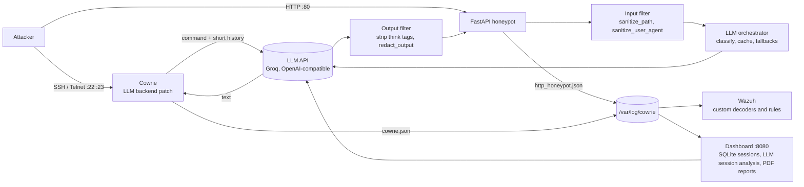

# Next-Generation AI Honeypot (GhostNet)

A lab honeypot that answers attackers with text generated by an LLM instead of canned files. An SSH/Telnet service (Cowrie) and an HTTP service (FastAPI) pass what the attacker sent to an OpenAI-compatible chat API (Groq by default) and return the model's output as if it came from a real Ubuntu server. Everything is logged as JSON, forwarded to Wazuh, and ingested into a small SQLite-backed dashboard that can ask the model to summarise each session and map it to MITRE ATT&CK.

It was built as a four-person university project. See "Team" below for who did what.

## Architecture



Components:

- **SSH/Telnet** (`configs/protocol_patch.py`, `configs/cowrie.cfg`): the stock Cowrie image with its LLM protocol handler replaced. It tracks the working directory itself, answers a few commands (`pwd`, `whoami`, `id`, `uname -a`, `hostname`) statically, caches `ls` and `cat` results per path so repeated commands stay consistent, and sends everything else to the model with the last four commands as context. Markdown fences are stripped from the reply. The file keeps the upstream Cowrie copyright header (Cowrie is BSD-licensed).
- **HTTP** (`honeypot/http/`): a catch-all FastAPI app. For each request it classifies the probe (auth probe, sensitive-file scan, known scanner user agent, generic), picks a token budget, serves `/`, `/robots.txt` and similar from deterministic fallbacks, looks in a TTL cache, and otherwise asks the model. If the model times out or errors, it returns a fixed 403/404/500 page. It adds a 50-300 ms delay, Apache/PHP-style headers, and a per-IP sliding-window rate limiter to protect the API budget.
- **Analysis dashboard** (`dashboard/`, `honeypot/analysis/`, `scripts/`): tails the Cowrie and HTTP logs into `analysis.db`, groups HTTP requests into sessions, and calls the model to label each session (intent, risk level, kill-chain phase, MITRE techniques, IOCs). It can export per-session and batch PDF reports.
- **SIEM** (`configs/wazuh/`): Wazuh rules for Cowrie events and for the HTTP honeypot log. `setup.sh` can clone `wazuh-docker` next to this repo and mount the rules.

### What the "policy gate" is

It is a set of regular expressions and string checks in `honeypot/http/policies/sanitizer.py`, plus some post-processing in `response_policy.py`. It is not a model-based or semantic policy engine.

Input side (HTTP only):

- `sanitize_path` truncates the request path to 256 characters. If any of seven case-insensitive patterns matches (for example `ignore.*(previous|above|all).*instruction`, `system prompt`, `print|show|reveal ... key|secret|password`, `you are a`, `act as`, `forget everything`), the path is replaced with `/403-forbidden` before it reaches the prompt. Control characters are then removed.
- `sanitize_user_agent` truncates to 512 characters and removes control characters.

Output side (HTTP only):

- `<think>`/`<thought>` blocks are removed, code fences are stripped, and the text is cut to `MAX_RESPONSE_CHARS`.
- `redact_output` replaces five secret formats (NVIDIA `nvapi-`, OpenAI-style `sk-`, AWS `AKIA` key IDs, Slack tokens, GitHub `ghp_` tokens) with `[REDACTED]` and deletes a handful of self-disclosure phrases ("honeypot", "I am an AI", "as an AI", "I cannot help", and similar).

Known limits, some of which are pinned in `tests/test_sanitizer.py`:

- Only the URL path and `User-Agent` are filtered. The request method, other headers and the request body are not part of the prompt, but nothing filters them either.
- Patterns are matched before control characters are removed and `.` does not match a newline, so an injection phrase split by a newline passes the input filter.
- There is no equivalent filter on the SSH side. Commands typed into the Cowrie session go to the model unfiltered; only markdown fences are stripped from the answer.
- There is no pattern for Groq (`gsk_`) keys in the output redactor.

## Quick start

Requirements: Docker with Compose v2, and a Groq API key (or another OpenAI-compatible endpoint). Use a dedicated VM or an isolated network; the stack listens on ports 22, 23 and 80 and is meant to be attacked.

```bash
git clone https://github.com/khalilammarr/Next-Generation_AI_Honeypot.git
cd Next-Generation_AI_Honeypot

cp .env.example .env
$EDITOR .env                       # set GROQ_API_KEY and GRAFANA_ADMIN_PASSWORD

sudo mkdir -p /var/log/cowrie      # bind-mounted by the compose file
docker compose up -d --build
```

Ports 22 and 23 on the host must be free, so move the host's own sshd first or change the mappings in `docker-compose.yml`. The dashboard is at `http://127.0.0.1:8080`.

`./setup.sh` is an interactive alternative. It checks for Docker, asks for a provider and model, writes `.env`, optionally clones and starts Wazuh (`wazuh-docker` v4.14.4), and then runs `docker compose up -d --build`. It downloads the `gum` terminal UI helper into `.bin/` on first run.

### Dashboard exposure

The dashboard has no authentication. By default `docker-compose.yml` publishes it (and Grafana) on `127.0.0.1` only, and `python dashboard/app.py` binds to `127.0.0.1`. To reach it from another machine, set `DASHBOARD_BIND` (compose) or `DASHBOARD_HOST` (local run) in `.env` to a specific address, and put a VPN, SSH tunnel or authenticating reverse proxy in front of it. Do not publish it on `0.0.0.0` on an Internet-facing host.

The dashboard also sends each source IP to `ip-api.com` over plain HTTP for a country lookup, and sends session timelines (commands and requests, including attacker-supplied text) to the configured LLM provider for analysis. Consider that before running it with real traffic.

### Configuration

All settings are environment variables; `.env.example` lists them with defaults. The main ones are `GROQ_API_KEY`, `GROQ_BASE_URL`, `GROQ_MODEL` (default `llama-3.1-8b-instant`), `LLM_TIMEOUT_SECONDS`, `LLM_MAX_TOKENS`, `RESPONSE_CACHE_TTL_SECONDS`, `RATE_LIMIT_MAX_REQUESTS` and `FAST_SCANNER_MODE`. The persona the HTTP service plays is in `honeypot/http/personality.txt`; the SSH persona is the system prompt in `configs/protocol_patch.py` (a fictional oil and energy company, "Petro-Global Systems").

`configs/cowrie.cfg` is tracked with a placeholder `api_key`. The compose file passes the real key to the container through environment variables; do not put a real key in the config file.

### Tests

```bash
pip install -r requirements-dev.txt
pytest
```

The only automated tests cover the sanitizer (27 cases). The rest of the system was exercised by hand in the lab.

## What was observed in testing

All traffic in this project's test database came from the team's own machines, not from the Internet. Over 4 April to 5 May 2026 the analysis database recorded 1,337 HTTP sessions (about 24,300 requests) from two private-range source IPs and 70 SSH sessions (81 login events, 457 commands) from one private-range IP. The country lookup returns "Local" for all of them. The most frequent commands were `ls`, `cd` and `cat`, followed by `whoami`, `pwd` and `wget`. The HTTP user agents were mostly an ordinary Linux browser string, some `curl` and a few test strings.

The model analysed 963 of the 1,407 sessions; the dashboard's risk labels over them (low, medium, high, one critical) reflect what the model made of lab traffic and are not findings about real attackers. The database is not included in this repository.

Problems the code works around, which came out of running it against the model:

- Consistency: repeated `ls` or `cat` calls would otherwise produce different contents each time, so the SSH handler caches both per path and puts the known listing back into the prompt ("Do NOT invent different files").
- Output hygiene: markdown fences are stripped from SSH replies, and the HTTP path also removes `<think>` blocks, because both show up in model output.
- API latency and cost dominate HTTP behaviour, so scanner-style and common requests are answered from fallbacks and a TTL cache before the model is called, with a rate limiter in front.

No claim is made about how well this fools a real attacker or a fingerprinting tool; that was not measured.

## Layout

```
configs/            Cowrie config and LLM protocol patch, Wazuh decoders and rules
dashboard/          FastAPI dashboard (app.py) and single-page UI (index.html)
honeypot/http/      HTTP honeypot service (routers, policies, orchestrator, cache, rate limiter)
honeypot/analysis/  SQLite session store
scripts/            Log ingestion, LLM session analysis, PDF report generation
tests/              Sanitizer tests
docs/               Original project plan and LaTeX report
setup.sh            Interactive installer
```

`docs/PROJECT_MASTER_PLAN.md` is the plan written at the start of the project. It names a local Qwen model, LangChain, Redis and an MQTT event bus. The implementation uses a hosted OpenAI-compatible API and none of those.

Wazuh note: the older `configs/wazuh/rules/custom_http_honeypot_rules.xml` matches an event id (`http.honeypot.hit`) that the current HTTP service does not emit. `configs/wazuh/decoders/ghostnet_http_decoder.xml` and `configs/wazuh/rules/ghostnet_http_rules.xml` match the events the service writes today (`transaction`, `login_view`, `credential_harvest`). `setup.sh` only mounts the two original rule files, so the decoder and its rules have to be mounted by hand.

## Safety

This is an active deception system. Run it only on infrastructure you own, isolated from anything you care about, and review the legal position of logging third-party traffic where you operate.

## Team

University project by four people. Roles are from the commit history and `git blame`; line counts are approximate.

- Khalil Ammar: HTTP orchestrator, sanitizer and policy modules, Cowrie configuration and LLM integration, `setup.sh`, dashboard backend and session ingestion, Wazuh rules for Cowrie, project report (about 3,900 lines of the current tree).
- Mariem Benabid: dashboard front end and theming (about 1,500 lines).
- Yasmine Ouerghi: session database and analysis work, PDF report generator (about 1,000 lines).
- Ben-Ammar-Sabri: Wazuh rules for the HTTP honeypot (about 90 lines).

## License

No license has been chosen for this repository, so all rights are reserved by the authors. `configs/protocol_patch.py` is derived from Cowrie and keeps its original BSD copyright notice.
