<p align="center"></p>

A lab honeypot that answers attackers with text generated by an LLM instead of canned files. An SSH/Telnet service (Cowrie) and an HTTP service (FastAPI) pass what the attacker sent to an OpenAI-compatible chat API (Groq by default) and return the output as if it came from a real Ubuntu server. Everything is logged as JSON, forwarded to Wazuh, and ingested into a small SQLite-backed dashboard that can ask the model to summarise each session and map it to MITRE ATT&CK. It was built as a four-person university project; see "Team" below.

## How it works

<p align="center"></p>

<sub>Diagram source: [docs/diagrams/readme-diagram.mmd](docs/diagrams/readme-diagram.mmd)</sub>


- **SSH/Telnet** (`configs/protocol_patch.py`, `configs/cowrie.cfg`): the stock Cowrie image with its LLM protocol handler replaced. It tracks the working directory, answers a few commands (`pwd`, `whoami`, `id`, `uname -a`, `hostname`) statically, caches `ls` and `cat` per path so repeated commands stay consistent, and sends everything else to the model with the last four commands as context.
- **HTTP** (`honeypot/http/`): a catch-all FastAPI app. It classifies each probe, serves common paths from deterministic fallbacks, checks a TTL cache, and otherwise asks the model. On a timeout or error it returns a fixed 403/404/500 page. It adds a short random delay, Apache/PHP-style headers and a per-IP rate limiter to protect the API budget.
- **Dashboard** (`dashboard/`, `honeypot/analysis/`, `scripts/`): tails the Cowrie and HTTP logs into `analysis.db`, groups requests into sessions, and has the model label each one (intent, risk, kill-chain phase, techniques, IOCs). It exports PDF reports.
- **SIEM** (`configs/wazuh/`): Wazuh rules for Cowrie events and the HTTP log. `setup.sh` can clone `wazuh-docker` next to this repo and mount the rules.

### The "policy gate" is regex, not a model

`honeypot/http/policies/sanitizer.py` and `response_policy.py` truncate the path and `User-Agent`, replace the path with `/403-forbidden` when it matches one of seven prompt-injection patterns, strip `<think>` blocks and code fences from replies, and redact five secret formats and a few self-disclosure phrases ("honeypot", "as an AI"). Limits, some pinned in `tests/test_sanitizer.py`:

- Only the path and `User-Agent` are filtered; the method, other headers and the body are not part of the prompt, but nothing filters them either.
- Patterns run before control characters are removed and `.` does not match a newline, so an injection phrase split by a newline passes.
- The SSH side has no equivalent filter: typed commands go to the model unfiltered and only markdown fences are stripped from the answer.
- The output redactor has no pattern for Groq (`gsk_`) keys.

## Quick start

You need Docker with Compose v2 and a Groq API key (or another OpenAI-compatible endpoint). Use a dedicated VM or an isolated network: the stack listens on ports 22, 23 and 80 and is meant to be attacked.

```bash
git clone https://github.com/khalilammarr/Next-Generation_AI_Honeypot.git
cd Next-Generation_AI_Honeypot
cp .env.example .env
$EDITOR .env                       # set GROQ_API_KEY and GRAFANA_ADMIN_PASSWORD
sudo mkdir -p /var/log/cowrie      # bind-mounted by the compose file
docker compose up -d --build
```

Ports 22 and 23 on the host must be free, so move the host's sshd first or change the mappings in `docker-compose.yml`. The dashboard is at `http://127.0.0.1:8080`. `./setup.sh` is an interactive alternative that writes `.env` and can also start Wazuh (`wazuh-docker` v4.14.4).

Settings are environment variables listed in `.env.example` (model default `llama-3.1-8b-instant`). The HTTP persona is `honeypot/http/personality.txt`; the SSH persona is the system prompt in `configs/protocol_patch.py`. `configs/cowrie.cfg` holds a placeholder `api_key`; the compose file passes the real key through the environment, so never put one in the config file.

Tests: `pip install -r requirements-dev.txt && pytest`. They cover only the sanitizer (27 cases); the rest was exercised by hand in the lab.

## Notes and limits

- **The dashboard has no authentication.** It binds to `127.0.0.1` by default. To expose it, set `DASHBOARD_BIND` (compose) or `DASHBOARD_HOST` (local run) and put a VPN, SSH tunnel or authenticating proxy in front. Never publish it on `0.0.0.0` on an Internet-facing host.
- The dashboard sends each source IP to `ip-api.com` over plain HTTP for a country lookup, and sends session timelines, including attacker-supplied text, to the configured LLM provider.
- **Observed in testing:** all traffic came from the team's own machines. Between 4 April and 5 May 2026 the database recorded 1,337 HTTP sessions and 70 SSH sessions from private-range IPs. The model analysed 963 of the 1,407 sessions; its risk labels reflect lab traffic and are not findings about real attackers. The database is not included.
- How well this fools a real attacker or a fingerprinting tool was not measured.
- `docs/PROJECT_MASTER_PLAN.md` is the original plan. It names a local Qwen model, LangChain, Redis and an MQTT event bus; the implementation uses a hosted OpenAI-compatible API and none of those.
- Wazuh: `custom_http_honeypot_rules.xml` matches an event id (`http.honeypot.hit`) the HTTP service no longer emits. `ghostnet_http_decoder.xml` and `ghostnet_http_rules.xml` match the current events, but `setup.sh` only mounts the two original rule files, so mount those by hand.
- This is an active deception system. Run it only on infrastructure you own, isolated from anything you care about, and check the legal position of logging third-party traffic where you operate.

## License

No license has been chosen, so all rights are reserved by the authors. `configs/protocol_patch.py` is derived from Cowrie and keeps its original BSD copyright notice.
