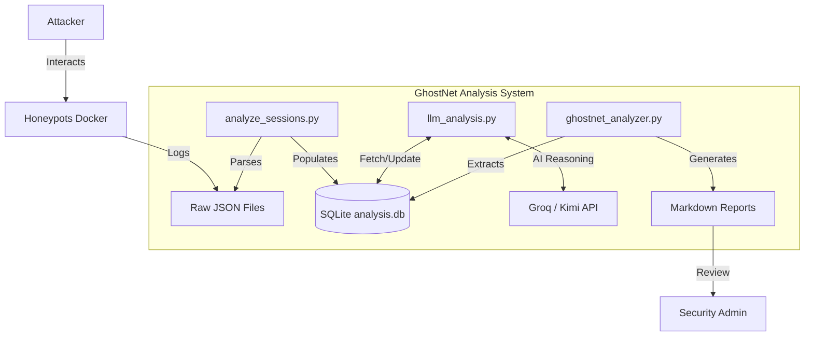

# 🕸️ GhostNet: Session Analysis & Reporting Platform
**Technical Integration Blueprint v2.1**

This document details the architecture of the **GhostNet Analysis System**, a post-processing layer that transforms raw, asynchronous logs into structured, AI-enriched security intelligence.

---

## 🏗️ 1. Technical Architecture

### 📊 Data Storage Layer (SQLite)
We use a lightweight **SQLite** database (`analysis.db`) to maintain a persistent audit trail.

**Schema Overview:**
*   **`sessions` Table**: Tracks high-level attack windows.
    *   `session_id`: Unique token from Cowrie/HTTP.
    *   `ip_address`, `protocol`, `start_time`, `end_time`.
    *   `risk_level`: [Low | Medium | High | Critical].
    *   `analysis_summary`: 2-3 sentence AI overview.
    *   `mitre_mapping`: JSON list of TTPs (e.g., T1059.004).
*   **`events` Table**: Individual interactions.
    *   `event_type`: [COMMAND | REQUEST].
    *   `raw_data`: The attacker's input.
    *   `output`: The AI's generated response (if available).

### 🧠 Analysis Engine (Groq + Kimi-k2)
*   **Reasoning Model**: `moonshotai/kimi-k2-instruct` via Groq.
*   **Analysis Core**: `scripts/llm_analysis.py` fetches the session chronology and performs behavioral labeling.
*   **Context Injection**: The engine provides the LLM with the full timeline to ensure it understands the "story" of the attack, not just isolated commands.

---

## 🔁 2. The Intelligence Pipeline (Process Flow)

1.  **Ingestion** (`analyze_sessions.py`): Parses raw JSON logs from `/var/log/cowrie/` and populates the SQLite tables.
2.  **Structuring**: Reconstructs fragmented logs into a logical sequence (Timeline).
3.  **Refinement**: The LLM analyzes the timeline to identify **Attacker Intent** and **MITRE Tactic** mappings.
4.  **Reporting** (`ghostnet_analyzer.py`): Generates a polished Markdown report in the `/reports/` directory.

---

## 🗺️ 3. Component Interaction Diagram

---

## 🛡️ 4. Security & Performance
*   **Privacy**: API keys are stored in `.env` and never logged or exposed.
*   **Rate Limiting**: Ingestion is decoupled from analysis to prevent API token exhaustion during heavy brute-force attacks.
*   **Persistence**: SQLite ensures all data is saved even if Docker containers are restarted.

---

## 🛠️ 5. Deployment Readiness
1.  **Dependencies**: `pip install openai python-dotenv`
2.  **Configuration**: Ensure `GROQ_API_KEY` is set in `.env`.
3.  **Execution**: `python scripts/ghostnet_analyzer.py --ingest --list`
