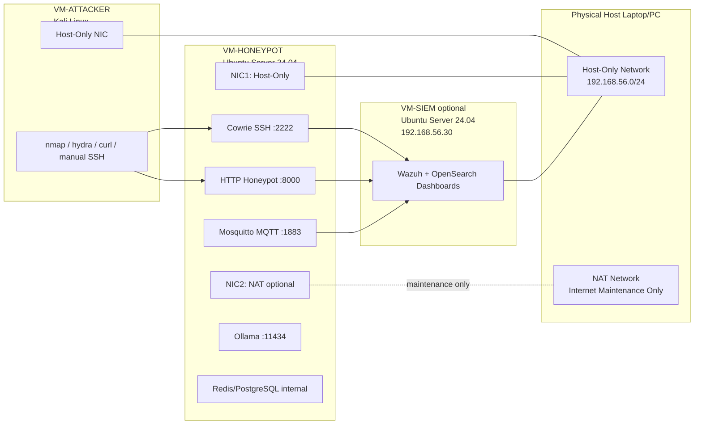

# Stack_LOCK.md — Référence Technique Verrouillée

## 1) Purpose and Scope
This document is the **single source of truth** for technology choices in the Intelligent Multi-Agent LLM Honeypot project.

- Status: **LOCKED for MVP**
- Any deviation requires a change request (see Section 12).
- Priority order: **Safety > Reproducibility > Detection value > Feature richness**

---

## 2) MVP Locked Stack (Authoritative)

| Layer | Locked Choice | Role in Architecture | Lock Level |
|---|---|---|---|
| SSH Honeypot | **Cowrie** | Medium-interaction SSH deception and attacker command capture | Hard lock |
| HTTP Honeypot | **FastAPI custom deceptive service** | Dynamic fake admin/API/login flows | Hard lock |
| LLM Runtime | **Qwen2.5 7B Instruct (local)** | Dynamic response generation under policy | Hard lock |
| LLM Access | **Ollama API** | Local inference serving | Hard lock |
| Orchestration | **LangChain (minimal)** | Prompt routing, context shaping, guardrail wrapping | Soft lock |
| Event Bus | **MQTT (Mosquitto)** | Inter-agent threat intel and event fanout | Hard lock |
| SIEM/SOC | **Wazuh + OpenSearch Dashboards** | Alerting, triage, SOC visibility | Hard lock |
| IDS | **Suricata** | Signature-based network detections | Hard lock |
| Relational DB | **PostgreSQL 16** | Structured analytics, reports, contract-backed storage | Hard lock |
| Cache/Session | **Redis 7** | Ephemeral state, counters, throttling | Hard lock |
| Deployment | **Docker Compose** | Reproducible multi-service deployment | Hard lock |
| Reverse Proxy | **Nginx** | Routing and optional TLS termination | Soft lock |

---

## 3) Alternatives Comparison (Why these choices)

### 3.1 Honeypot Layer
| Option | Advantages | Risks / Limits | Decision |
|---|---|---|---|
| Cowrie | Mature, realistic SSH emulation, rich logs | Requires tuning for realism | **Selected** |
| OpenCanary SSH | Quick setup | Less depth for command/session analytics | Rejected |
| Custom Paramiko | Full control | High dev time and lower reliability | Rejected |

### 3.2 SIEM Layer
| Option | Advantages | Risks / Limits | Decision |
|---|---|---|---|
| Wazuh + OpenSearch | SOC-native workflows, strong OSS security ecosystem | Heavier footprint | **Selected** |
| ELK-only | Very flexible | More custom security engineering needed | Rejected (MVP) |
| Graylog | Easy operations | Less security depth for this use-case | Rejected |
| Security Onion | Very powerful NSM | Heavy and complex for team timeline | Rejected |

### 3.2.1 SIEM Benchmark (Weighted, MVP-Oriented)

Scoring model:
- Scale: 1 (weak) to 5 (excellent)
- Context: team of 4, 8–12 weeks, honeypot-first SOC outcomes
- Weights:
   - Deployment simplicity (20%)
   - Hardware footprint efficiency (10%)
   - Detection capability (20%)
   - Alert workflow maturity (15%)
   - Integration with Suricata/Cowrie/custom JSON (15%)
   - Dashboard/analyst usability (10%)
   - Maintenance overhead (10%)

| SIEM Option | Deploy Simplicity | HW Efficiency | Detection Depth | Alert Workflow | Integration Fit | Dashboard UX | Maintenance | Weighted Score (/5) | Rank |
|---|---:|---:|---:|---:|---:|---:|---:|---:|---:|
| **Wazuh + OpenSearch** | 4 | 4 | 4 | 3 | 5 | 4 | 4 | **4.00** | **1** |
| OpenSearch Security Analytics | 3 | 3 | 4 | 4 | 3 | 4 | 3 | 3.40 | 2 |
| Graylog | 3 | 3 | 3 | 3 | 4 | 3 | 3 | 3.10 | 3 |
| Security Onion | 2 | 2 | 5 | 4 | 4 | 4 | 2 | 3.30 | 4* |
| ELK-only (OSS style) | 2 | 3 | 2 | 2 | 4 | 4 | 2 | 2.55 | 5 |

\*Security Onion has strong technical capability but lower delivery fit in the project timeline due to operational complexity and resource load.

Decision outcome:
- **MVP winner: Wazuh + OpenSearch**
- **V2 candidate: OpenSearch Security Analytics** (for richer detector customization)

Context7 validation highlights used in scoring:
- Wazuh supports ingesting Suricata EVE JSON via agent localfile (`/var/log/suricata/eve.json`) and can forward/process structured alert JSON pipelines.
- OpenSearch Security Analytics requires detector/log-type field mappings and custom log-type mapping work for non-standard telemetry.
- Graylog provides robust syslog/JSON ingestion, pre-index pipelines, and event/notification workflows, but less security-native depth than Wazuh for this specific SOC-learning scope.

### 3.3 Multi-Agent Messaging
| Option | Advantages | Risks / Limits | Decision |
|---|---|---|---|
| MQTT | Lightweight topics, simple federation, ideal for distributed sensors | Needs ACL discipline | **Selected** |
| Redis Pub/Sub | Fast and simple | Weaker protocol-level controls for distributed edge | Rejected |
| NATS | High performance and robust | Extra complexity for MVP | Rejected |

### 3.4 LLM Models (Local)
| Model | Strength | Constraint | Decision |
|---|---|---|---|
| Qwen2.5 7B Instruct | Strong instruction following, efficient | Requires strict prompt controls | **Primary** |
| Llama 3.1 8B | High quality | Heavier resources | Backup |
| Mistral 7B | Fast | Less consistent for complex policy prompts | Backup |

---

## 4) Protocol Lock (Usage + Controls)

| Protocol | Project Usage | Mandatory Controls | Exposure Policy |
|---|---|---|---|
| SSH | Attack interaction channel | Rate-limits, full session logs, no real shell | Exposed only in lab network |
| HTTP/HTTPS | Deceptive web/admin/API flows | Input validation, synthetic data only, strict response policy | Exposed only in lab network |
| MQTT | Agent-to-agent intelligence sharing | ACL + auth + dedicated internal subnet + topic partitioning | Internal only |
| REST | Internal APIs (adapter/detection/admin) | Token auth + schema validation + timeout controls | Internal only |
| Syslog/JSON | SIEM ingestion | UTC timestamps, normalized schema, source tagging | Internal only |

---

## 5) Network Lock (Lab Topology)

## 5.1 VM Network Modes (Mandatory)
- Honeypot VM NIC1: **Host-Only** (attack surface + inter-VM lab traffic)
- Honeypot VM NIC2: **NAT (maintenance only)**
- Attacker machine: Host-Only on same lab subnet

## 5.2 NAT Safety Policy
- No port forwarding on NAT interface
- Disable IP forwarding on honeypot host (`net.ipv4.ip_forward=0`)
- During attack experiments, NAT should be disabled when not needed
- Firewall default-deny outbound except maintenance windows

## 5.3 Reference Lab Addressing
| Host | Suggested IP | Role |
|---|---|---|
| Honeypot VM | `192.168.56.10/24` | Core services |
| Attacker machine | `192.168.56.20/24` | Validation traffic |
| Optional SIEM node | `192.168.56.30/24` | Segregated analytics |

## 5.4 Recommended Lab Machines (Best Practical Setup)

| Machine | OS Choice | Why this choice | Network Mode |
|---|---|---|---|
| Honeypot server VM | **Ubuntu Server 24.04 LTS** | Stable long-term packages, Docker-friendly, large community docs | NIC1 Host-Only, NIC2 NAT (maintenance only) |
| Attacker workstation | **Kali Linux (latest stable)** | Ready-to-use offensive testing toolset for controlled validation | Host-Only |
| SIEM/Analytics VM (optional but recommended) | **Ubuntu Server 24.04 LTS** | Best compatibility for Wazuh/OpenSearch compose-style deployment | Host-Only (optional NAT during updates) |

Notes:
- Arch Linux is powerful but not preferred for this project baseline due to rolling-release variability during team-based reproducibility.
- Keep all attack simulations inside Host-Only network.
- NAT should be enabled only for updates and disabled during adversarial test sessions.

## 5.5 Lab Topology Diagram (Mermaid)



---

## 6) Container and Service Lock

| Service | Image/Build | Ports | Persistence |
|---|---|---|---|
| Cowrie | `cowrie/cowrie:latest` (pin later) | `2222/tcp` | Cowrie logs volume |
| HTTP Honeypot | `./honeypot/http` Dockerfile | `8000/tcp` | App logs + templates |
| Mosquitto | `eclipse-mosquitto:latest` (pin later) | `1883/tcp`, `9001/tcp (optional)` | Config volume |
| Ollama | `ollama/ollama:latest` (pin later) | `11434/tcp` | Model cache volume |
| Wazuh + OpenSearch | official compose profile | stack-specific | Index volumes |
| Redis | `redis:7` | `6379/tcp` internal | optional |
| PostgreSQL | `postgres:16` | `5432/tcp` internal | DB volume |

> Rule: replace `latest` by pinned tags at implementation freeze.

---

## 7) Data Contracts Lock (Minimum Fields)

## 7.1 Event Contract (Mandatory fields)
| Field | Type | Description |
|---|---|---|
| `timestamp` | ISO8601 UTC | Event time |
| `event_id` | string | Unique event identifier |
| `session_id` | string | Correlated attacker session |
| `agent_id` | string | Honeypot node identity |
| `src_ip` | string | Attacker source IP |
| `service` | enum(ssh,http,...) | Surface where event occurred |
| `action` | string | Normalized attacker action |
| `raw_input` | string | Raw command/request excerpt |
| `severity` | enum(low,medium,high,critical) | Risk level |
| `ttp` | string | ATT&CK technique identifier |

## 7.2 Alert Contract (Mandatory fields)
| Field | Type | Description |
|---|---|---|
| `alert_id` | string | Unique alert |
| `rule_id` | string | Triggered detection rule |
| `confidence` | float | 0.0–1.0 |
| `evidence` | array | Event references/snippets |
| `mitre_technique` | string | ATT&CK technique |
| `session_id` | string | Related attacker session |

## 7.3 Inter-Agent Intel Message Contract
| Field | Type | Description |
|---|---|---|
| `intel_type` | enum(ip_reputation,ttp_observed,campaign_hint) | Message type |
| `value` | string | IOC or intelligence value |
| `confidence` | float | 0.0–1.0 |
| `ttl_seconds` | int | Expiration time |
| `source_agent` | string | Origin node |

---

## 8) LLM Safety and Policy Lock

| Policy Area | Locked Rule |
|---|---|
| Execution safety | LLM never executes host/system commands |
| Response bounds | Max token output and timeout enforced |
| Prompt safety | Strip attacker prompt-injection artifacts where possible |
| Fallback path | Deterministic templates if confidence/policy fails |
| Data safety | No real credentials/secrets in prompts or responses |
| Style realism | Service-like concise outputs; no chatbot tone |

---

## 9) Performance and KPI Baselines (MVP)

| KPI | Target | Measurement Method |
|---|---|---|
| Event completeness | `>= 90%` mandatory fields | Contract validation on captured events |
| LLM response latency | p95 `<= 1.2s` (lab hardware dependent) | Timed orchestration logs |
| Detection precision (baseline scenarios) | `>= 0.80` | Labeled replay test suite |
| Containment violations | `0` | Firewall + route + egress audits |
| Inter-agent intel propagation | `< 3s` in lab | MQTT publish/receive timestamps |

---

## 10) Security Baseline Checklist

- Non-root containers where possible
- Restricted capabilities and read-only FS where practical
- UFW/iptables default deny on non-required paths
- No external exposure to public internet during validation
- Secrets via environment files (never hardcoded)
- Audit logs preserved for demo/report evidence

---

## 11) Minimum Hardware Sizing (Lab)

| Node | CPU | RAM | Storage |
|---|---|---|---|
| Honeypot VM (all-in-one MVP) | 4 vCPU | 8–12 GB | 80+ GB |
| Attacker machine | 2 vCPU | 4 GB | 40 GB |
| Optional separate SIEM node | 4–8 vCPU | 8–16 GB | 100+ GB |

> If resources are limited, reduce model size before dropping SIEM observability.

---

## 12) Change Control Policy

Any stack change requires:
1. Problem statement
2. Impact analysis (security, performance, timeline)
3. Migration plan
4. Rollback plan
5. Update in:
   - `EnhancedPlanUnified.md`
   - `ExectuionTaskBreakdown.md`
   - this `Stack_LOCK.md`

### Change Request Template
```md
## Stack Change Request
- Date:
- Requested by:
- Current component:
- Proposed replacement:
- Reason:
- Security impact:
- Performance impact:
- Timeline impact:
- Rollback strategy:
- Decision:
```

---

## 13) Final Statement
For MVP, this stack is intentionally conservative and execution-focused: it maximizes delivery confidence, SOC relevance, and evaluation quality while controlling complexity and risk.
